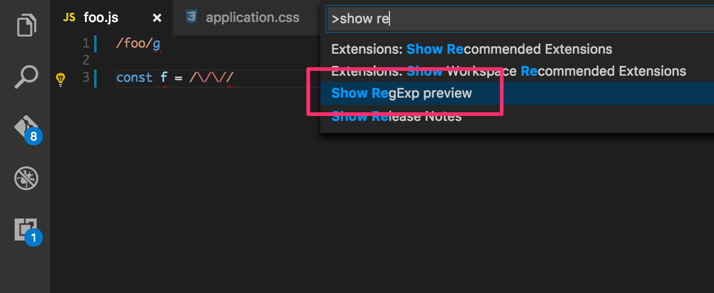
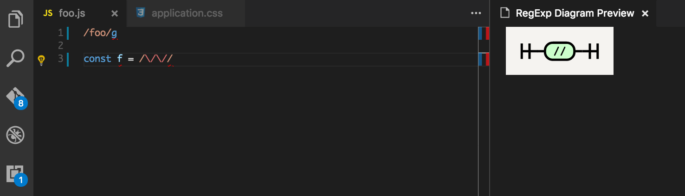

半年くらい前に作業用のエディタをAtomからVSCodeに切り替えた。
TypeScriptに最適化されていてとても快適なんだけど、Atomで常用していたあるプラグインの代替となる拡張機能が無かった。

[atom-regex-railroad-diagrams](https://github.com/klorenz/atom-regex-railroad-diagrams)というプラグインで、正規表現をダイアグラムとして表示してくれるというもの。
かなしいことに私は正規表現が苦手で、書いたパターンが実際にどんな文字列にマッチするのかイマイチイメージできないのだが、このプラグインを使うと視覚的にわかりやすい形で書いたパターンを確認できていた。

VSCodeに移行してからも、正規表現を書くときだけAtomを起動してダイアグラムを確認するような生活を送っていたのだが、それもかなしいのでVSCode向けに同じような機能を持った拡張機能を作ってみることにした。

[vscode-regex-railroad-diagrams](https://marketplace.visualstudio.com/items?itemName=kogai.regex-railroad-diagrams)

同じElectronベースのエディタということで中核となる実装はほとんどそのまま流用しつつ、VSCodeとの橋渡しに成るインタフェースを作った感じだ。
作ってみて思ったのが、同じElectronベースのエディタとはいえ、結構APIに違いがあるようだった。

特にAtomは直接プラグインのコードでDOM要素に手を触れることができるようだが、VSCodeではそういったインタフェースはないようで、特定のライフサイクルの時に呼ばれる関数にHTMLとして評価できる文字列を渡すことで細かくスタイリングしたHTML要素を描画した。
あと、Atomでは正規表現部分を囲むCSSクラスがあるので正規表現を表す文字列を簡単に取得できていたのだが、VSCodeではそういう風にはなっていなかったので、正規表現部分を抽出するコードを書く必要があった。

Atomだとこういう感じ

```html
<span class="string regexp js">
  <span class="punctuation definition string begin js">/</span>
  foo
  <span class="punctuation definition string end js">/</span>
</span>
```

VSCodeだとこういう感じ

```html
<span>
  <span class="token meta var expr js string regex punctuation definition begin">/</span>
  <span class="token meta var expr js string regex">foo</span>
  <span class="token meta var expr js string regex punctuation definition end">/</span>
</span>
```

動かしてみたところはこんな感じ。

Cmd + Shift + P から `Show RegExp preview`コマンドを打つ


こんな感じでダイアグラムが表示される



よかったら使ってみて下さい。
